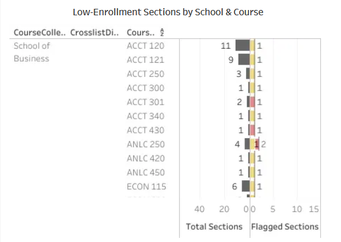
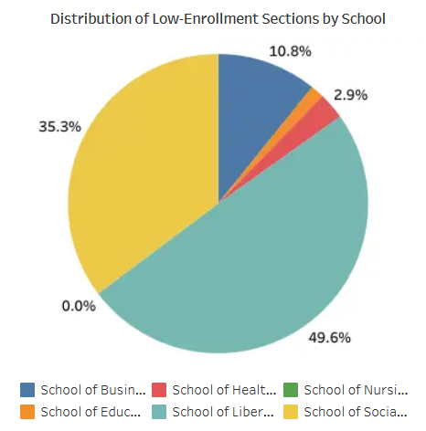
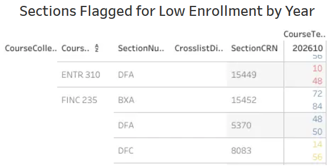

# Academic Enrollment Risk & Capacity Utilization Analysis

### An Interactive Tableau Framework for Academic Planning and Institutional Research

**Research areas:** Educational Data Analytics · Institutional Research · Business Intelligence · Decision Support Systems  
**Tools:** Tableau · SQL · Argos · Banner SIS

## Overview

This project develops an interactive enrollment monitoring framework to identify under-enrolled course sections, compare flagged sections with total course offerings, and examine the distribution of enrollment risk across academic schools. The dashboard transforms institutional course-section records into interpretable indicators for academic scheduling and resource planning.

## Research Questions

1. Which sections have enrollment substantially below their assigned capacity?
2. How are flagged sections distributed across schools and courses?
3. How do flagged section counts compare with the total sections offered for each course?

## Data and Methods

The analysis uses institutional course-section data accessed through academic reporting systems, including Banner SIS and Argos. Relevant fields include academic term (`CourseTermCode`), school (`CourseCollege`), course (`CoursebySubject`), section (`SectionNumber`), CRN (`SectionCRN`), enrollment (`SectionEnrollCount`), capacity (`SectionCapacity`), campus, instructional method, and cross-list information.

For sections with valid positive capacity, utilization is defined as:

\[
\text{Enrollment utilization (\%)} = \frac{\text{Section enrollment}}{\text{Section capacity}} \times 100
\]

| Classification | Utilization | Interpretation |
|---|---|---|
| 🔴 Red | Below 25% | Critical under-enrollment |
| 🟡 Yellow | 25% to below 50% | Moderate under-enrollment |
| 🔵 Blue | 50% or higher | Not flagged under the selected thresholds |
| ⚪ Gray / N/A | Missing or invalid capacity | Cannot classify reliably |

**Flagged sections** are defined as sections below 50% utilization. These are operational screening thresholds, not validated predictions of course cancellation or financial viability.

### Analytical Workflow

1. **Prepare records:** Organize enrollment, capacity, course, term, and section identifiers; identify missing or invalid capacities.
2. **Classify sections:** Apply the utilization thresholds to distinguish critical, moderate, and non-flagged sections.
3. **Aggregate outcomes:** Count flagged sections by school/course and compare them with distinct total sections within the selected term.
4. **Build interactive views:** Apply Tableau filters for term, campus, school, instructional method, and active status.

## Dashboard Visualizations

### Figure 1 — Enrollment Risk vs. Total Course Sections



*Figure 1.* Mirrored horizontal bars compare total course sections (gray); with sections below 25% capacity (red); and from 25% to below 50% capacity (yellow). This contextualizes flagged counts against overall course offerings.

### Figure 2 — Distribution of Flagged Sections by School



*Figure 2.* The pie chart shows each school's **share of all flagged sections**, rather than the within-school under-enrollment rate. In the displayed selection, the School of Liberal Arts accounts for approximately **49.6%** of flagged sections and the School of Social and Behavioral Sciences for **35.3%**. These values describe the displayed filtered view, not a universal institutional pattern.

### Figure 3 — Section-Level Enrollment and Capacity Detail



*Figure 3.* The detailed table identifies courses, sections, CRNs, and enrollment relative to capacity, with risk-based text colors. It supports investigation of specific records behind the aggregate patterns.

## Interpretation and Applications

The dashboard provides descriptive evidence to support:

- **Enrollment monitoring:** Locate sections with low enrollment relative to capacity.
- **Scheduling review:** Identify courses with multiple flagged sections.
- **Resource planning:** Compare under-enrollment with total course offerings.
- **Institutional research:** Explore variation across schools, terms, campuses, and instructional methods.

The visualizations support administrative review; they do not establish why enrollment is low or automatically justify cancellation or reallocation.

## Limitations

- Enrollment counts can change during registration.
- Capacity thresholds may not be equally appropriate across programs or course types.
- A school's share of flagged sections is **not** its own under-enrollment rate.
- Utilization alone does not measure financial performance, educational quality, or student outcomes.
- Counts must be interpreted within the selected term and filter context; section CRNs are term-specific.

## Future Research

- **Predictive enrollment modeling:** Evaluate historical demand and forecasting methods such as XGBoost to anticipate section enrollment.
- **Longitudinal analysis:** Investigate seasonal and multi-year patterns in low utilization.
- **Classroom allocation:** Combine enrollment estimates with room capacities, campus restrictions, and availability.
- **Threshold sensitivity:** Test how alternative risk cutoffs affect the number and distribution of flagged sections.
- **Decision-support evaluation:** Assess whether systematic monitoring improves planning consistency or timeliness.

## Data Privacy and Reproducibility

Institutional administrative records may be restricted. Public repositories should contain only authorized, de-identified, aggregated, or synthetic data. The methodology can be reproduced with equivalent course-section identifiers, enrollment measures, capacity values, and organizational classifications.

## Repository Structure

```text
academic-enrollment-risk-analysis/
├── README.md
└── images/
    ├── 01_enrollment_risk_vs_total_sections.png
    ├── 02_flagged_sections_by_school.png
    └── 03_section_enrollment_capacity_detail.png
```

## Conclusion

This project demonstrates an applied institutional research workflow that converts academic administrative data into interpretable enrollment-risk indicators. Its section-level, course-level, and school-level perspectives establish a foundation for more advanced predictive modeling and resource-allocation research.

**Keywords:** Institutional Research · Enrollment Analytics · Capacity Utilization · Tableau · Educational Data Mining · Decision Support
